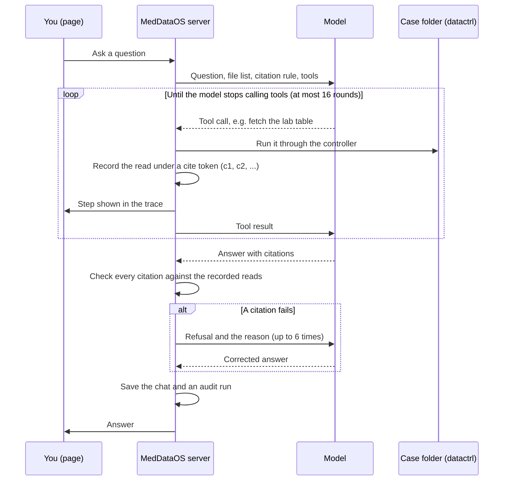

# How it works

MedDataOS is a harness: the server runs the conversation with the model itself, gives it tools to read the case, and checks the answer before the page shows it. This page follows one question through it.

## A question, step by step

1. **The model gets the question and a map of the case**: the list of files, the citation rule, the tools it may call, and short descriptions of the domain skills.
2. **It reads what it needs.** Each `describe` or `fetch` goes through the controller, which returns a bounded slice (a page of rows, a note's text, a DICOM volume saved to disk) and never the whole case. The server records each read under a cite token.
3. **It may delegate.** The router is told what each agent can use right now (connected MCP servers, and the sandbox when it can run) and one rule: launch an agent when that agent has tools the router does not, or when the work is many reads of one kind; do a quick lookup itself; launch several agents in one turn when a question spans areas. `load_skill` is for guidance its own tools can follow. If it loads a skill and lacks a tool from `requires` or `uses` that an agent can use right now, the reply names that agent; if none can, the reply says why. An agent is the same loop in a fresh context, with that agent's skills already in the prompt and only the tools the agent grants. Its answer is checked the same way and comes back as findings the main model cites, with ids such as `dicom.1`.
4. **It answers in a fixed format**: the response text with `[cite:c1]` markers, and one citation object per marker.
5. **The verifier checks it** against the recorded reads. A failure goes back to the model with the reason; after six failures the page says so instead of showing an unchecked answer. [Cited answers](citations.md) explains the checks.

At startup the server also asks the model to fill in the patient card, and, when the case has notes, builds the notes ledger in the background.

## What the model can use

| Capability | What it gives the model | Needs |
|---|---|---|
| Case reads | `discover`, `describe`, `fetch`, note search, DICOM trees and groups | Always on |
| Skills | Domain know-how for DICOM, notes and tables, loaded on demand. A skill grants no tools. | `skills/<name>/SKILL.md` |
| Agents | A fresh context with one or more skills preloaded and only the tools that agent grants | `agents/<name>.md` |
| Notes ledger | Facts extracted from every note, each tied to an exact quote, plus a timeline and the places notes disagree | A case with notes |
| Sandbox | `exec` to run Python on fetched volumes and tables; `view_image` to look at a figure | Docker ([guide](../guides/sandbox.md)) |
| References | Search and read allowlisted radiology reference sites | Network to those sites |
| MCP servers | Tools from other processes, such as TotalSegmentator for anatomy on CT | [Guide](../guides/mcp-servers.md) |

A capability that cannot run is simply not offered: no sandbox means no `exec`, no notes means no ledger tools. The full list is in [Tools](../reference/tools.md).

## What protects the data

The model works with patient data, so the harness limits what can leave the machine and what code can do.

- **The controller is the only path to the files.** No tool reads the folder any other way, so the audit log is complete.
- **The sandbox has no network.** Code runs in a fresh container per command, with the case read-only, the session workspace as the only writable folder, and limits on memory, CPU and time. It uses gVisor by default and refuses to run without it unless you name another runtime.
- **MCP servers run in the same kind of container.** A server from the shared project file starts only once you approve it on your machine, and again after any edit to it; every server's tool descriptions are pinned, so a changed tool is refused until someone reviews it.
- **Reference reads are screened.** A URL holding the patient's identifiers or a full date is refused, query strings are dropped, and redirects off the allowlist are not followed.
- **What goes to the model provider** is the conversation: the question, the tool results the model asked for, and its answers. Choose a provider and agreement that fit your data, or a local model.

## Two ways to run

By default the server talks to the model itself (harness mode). You can instead hand questions to an external agent that speaks the chat completions API, with `--agent-url`; the server still runs the tools and checks the answers. See [Use an external agent](../guides/external-agent.md).
